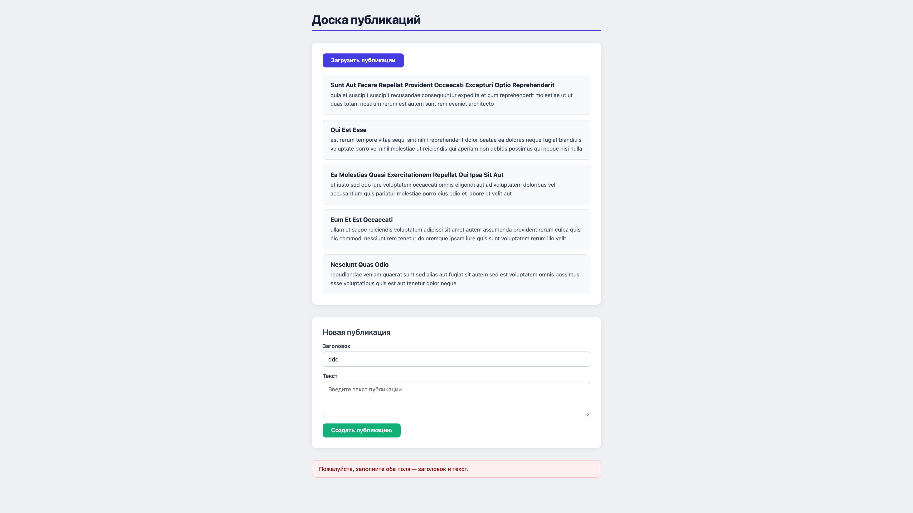

# Лабораторная работа №3 — Доска публикаций

## Запуск

Открыть файл `index.html` в браузере напрямую или через локальный сервер:

```bash
npx serve .
```

## Результаты проверки

| Сценарий | Ожидаемый результат | Статус |
|---|---|---|
| Нажать «Загрузить публикации» | Появляются 5 карточек с заголовком и текстом | ✅ |
| Отправить пустые поля | Ошибка «заполните оба поля», запрос не отправляется | ✅ |
| Отправить поля с одними пробелами | Та же ошибка валидации | ✅ |
| Отправить корректные заголовок и текст | HTTP 201, сообщение с ID и заголовком новой публикации | ✅ |
| Заменить URL на `/postz` (404) | Сообщение об ошибке, кнопка снова активна | ✅ |

## Превью роаботы 

